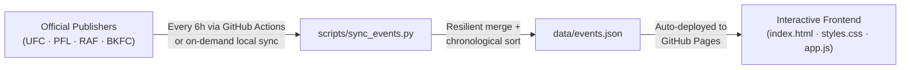

# Fight Night Countdown

[](https://github.com/boostx1/fight-night-countdown/actions/workflows/sync-events.yml)
[](https://github.com/boostx1/fight-night-countdown/actions/workflows/deploy-pages.yml)

**Live Demo:** [boostx1.github.io/fight-night-countdown](https://boostx1.github.io/fight-night-countdown/)

A live, self-updating countdown tracker for every upcoming **UFC**, **PFL**, **RAF Wrestling**, and **Bare Knuckle FC (BKFC)** event — sorted strictly in chronological order with official posters, venues, and ticking **Days : Hours : Minutes : Seconds** timers.

## Why I Built This

Keeping up with fight nights across multiple promotions usually means jumping between four different sites, converting timezones in your head, and figuring out what's actually on Friday vs. Saturday. I built this to put every confirmed card in one clean, fast dashboard that stays up to date on its own whenever a promotion announces a new event.

## Key Features

- **Strict Chronological Timeline:** Merges UFC, PFL, RAF Wrestling, and Bare Knuckle FC into one unified schedule sorted by exact UTC start time — so a Friday RAF or BKFC card always shows up right before Saturday's UFC card.
- **Live Ticking Timers:** Every card (plus the featured **Next Up** hero spotlight) counts down live in **Days, Hours, Minutes, and Seconds**, flips to **LIVE NOW** during fight night, and automatically moves on once the card wraps up.
- **Official Posters, Names & Locations:** Pulls official event artwork, titles, arenas, cities, and start times directly from the promotions.
- **Clean, Interactive UX:**
  - Filter by promotion with live event counts (`All`, `UFC`, `PFL`, `RAF Wrestling`, `Bare Knuckle FC`)
  - Instant search by fighter, event name, venue, or city
  - Switch between **Poster Grid** and **Timeline** views (grouped by month)
  - Automatic browser timezone detection plus a quick switcher (`Local`, `ET`, `CET`, `UTC`)
  - Click any event for prelims/main card breakdowns and one-click **Add to Calendar (`.ics`)** downloads
- **Always Up to Date:** A scheduled **GitHub Actions** job scrapes all four official publisher sites every 6 hours, commits any newly announced cards or poster updates to `data/events.json`, and redeploys the live site automatically.

## How It Works



## Tech Stack

Intentionally built with **zero external runtime dependencies** so it's fast, portable, and easy to maintain:

| Layer | Technology |
| --- | --- |
| Frontend | Semantic HTML5, Modern CSS Grid/Flexbox, Vanilla ES Modules |
| Data Sync | Python 3 standard library (`urllib`, `concurrent.futures`, `json`) |
| Local Dev Server | Python 3 `ThreadingHTTPServer` (`server.py`) with live `POST /api/sync` |
| Automation & Hosting | GitHub Actions (6-hour cron sync) + GitHub Pages |

## Project Structure

```text
.
├── index.html                           # App shell & modal layout
├── styles.css                           # Broadcast-inspired dark UI & responsive grid
├── app.js                               # Live 1s timer engine, filters, search & .ics export
├── server.py                            # Zero-dependency local server + live sync API
├── data/
│   └── events.json                      # Auto-synced chronological schedule
├── scripts/
│   └── sync_events.py                   # Multi-publisher official event scraper
└── .github/workflows/
    ├── sync-events.yml                  # Runs sync_events.py every 6 hours
    └── deploy-pages.yml                 # Auto-deploys to GitHub Pages on updates
```

## Run Locally

```bash
python3 server.py
```

Open **http://localhost:8080** in your browser. Click **Sync Now** in the top bar anytime to scrape the latest announcements live (or run `python3 scripts/sync_events.py` from the terminal).

## License

[MIT](LICENSE)
